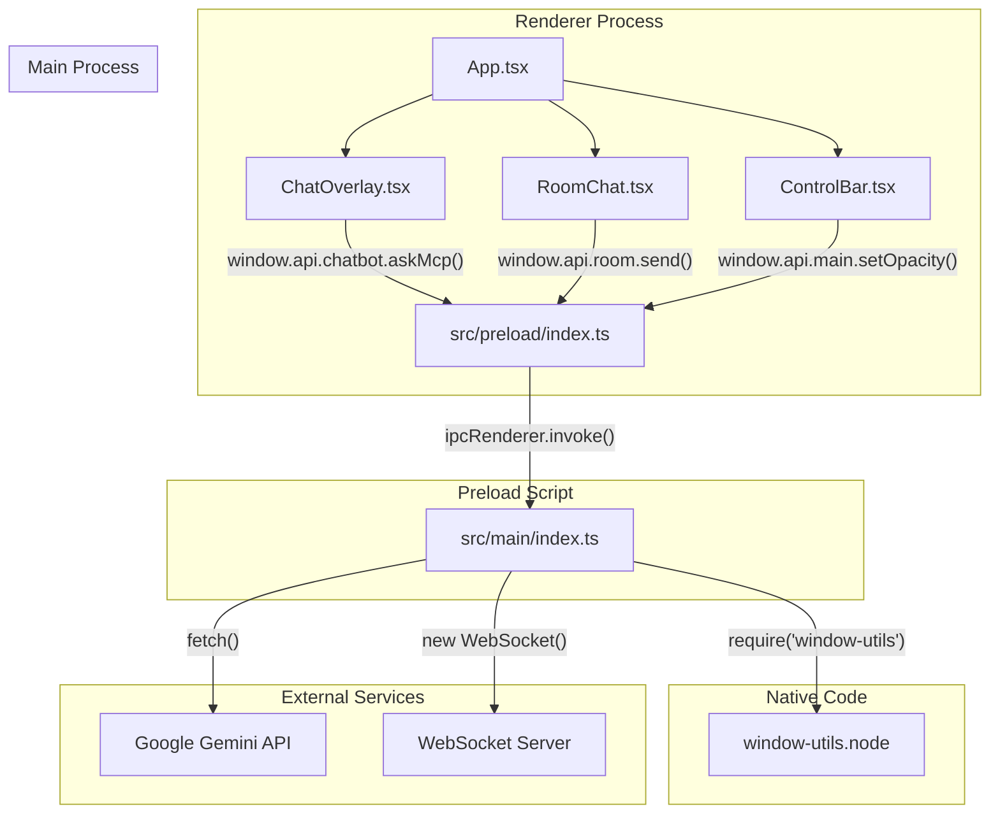

# Interview Life Saver

## Project Overview
Interview Life Saver is an Electron + React application designed to help users during online interviews. It provides:

- **LLM Chat Mode** - Gemini API-powered conversational assistant with system prompts
- **Room Mode** - WebSocket-based real-time chat rooms for group interviews
- **Screen Capture Protection** - Windows-only feature to hide windows from screen capture/recording
- **System Prompt Management** - Save, edit, and activate reusable system prompts

## Core Architecture

### Screen Capture Protection (Windows-only)
- Uses native C++ addon (`window-utils`) with `SetWindowDisplayAffinity(hwnd, WDA_EXCLUDEFROMCAPTURE)`
- Makes application invisible to screen recording tools while remaining visible to user
- Controlled via tray menu, control bar toggle, and global shortcuts (Alt+Shift+O for click-through, Alt+Shift+S for stealth)

### Gemini LLM Integration
- API key stored persistently in `userData/api-key.json`
- Free tier models: gemini-2.5-flash, gemini-2.5-flash-lite, gemini-2.0-flash, gemini-2.0-flash-lite
- Chat context includes system prompts when active
- Model selection via control bar or `/set-model` command

### Room/WebSocket Mode
- Connect to configurable WS URL (default: `wss://websocket-23q5.onrender.com`)
- Lobby system with room creation/joining (8-char uppercase keys)
- Text and image messaging with participant tracking
- Nickname persistence via `localStorage.room-nickname`

### System Prompts
- Stored in `localStorage.systemPrompts` (array of `{id, name, content}`)
- Active prompt prepended to Gemini chat requests
- Manage via ControlBar ⚙️ button or `open-system-prompt-modal` event

## Key Files

| File | Purpose |
|------|---------|
| `src/main/index.ts` | Electron main process - window creation, IPC handlers, Gemini, capture protection, WebSocket |
| `src/preload/index.ts` | Context bridge - exposes APIs to renderer via `window.api` and `window.electron` |
| `src/renderer/src/App.tsx` | Main app container with LLM/Room mode toggling |
| `src/renderer/src/ControlBar.tsx` | Fixed top bar with stealth/click-through/opacity/toggles |
| `src/renderer/src/ChatOverlay.tsx` | Floating chat with message history, system prompts, image attachment |
| `src/renderer/src/RoomChat.tsx` | Room-specific chat interface |
| `native-addon/window-utils/` | C++ N-API addon for Windows screen capture protection |
| `src/main/config.ts` | Configuration: `GEMINI_API_KEY`, `WS_URL` env vars |

## 1. Screen Capture Protection (Windows)

**How it works**: Uses `SetWindowDisplayAffinity` with `WDA_EXCLUDEFROMCAPTURE` flag (value 2) to make window invisible to screen capture APIs.

**Platform checks**: All functions verify `process.platform === 'win32'` before acting.

**Key functions** (in `src/main/index.ts`):
- `hideWindowFromCapture(window)` - Hide from screen capture
- `showWindowInCapture(window)` - Revert to normal visibility
- `getCaptureState(window)` - Return current affinity state

**Tray menu**: Shows/Hides app with automatic capture protection enable/disable
**Control bar**: Toggle button with shield/shield-off icons
**Shortcuts**: `Alt+Shift+O` (click-through), `Alt+Shift+S` (stealth mode)

**Build requirement**: Native addon must be built via `build-native-addon.bat` (requires Visual Studio C++ build tools, CMake).

## 2. Modules

### a. Main Process (`src/main`)

-   **Purpose**: Core application logic, window management, and backend operations.
-   **Main Files**:
    -   `index.ts`: The primary entry point. It handles app lifecycle events, creates the main `BrowserWindow`, sets up global shortcuts, creates the tray icon, and manages all IPC (Inter-Process Communication) handlers.
    -   `config.ts`: Loads and exports configuration variables (like API keys and WebSocket URLs) from environment variables (`.env` file).
-   **Dependencies**: `electron`, `@electron-toolkit/utils`, `node-fetch` (for Gemini API), `ws` (for WebSocket), and the local `window-utils` native addon.

### b. Preload Script (`src/preload`)

-   **Purpose**: To securely expose a well-defined API from the main process to the renderer process.
-   **Main Files**:
    -   `index.ts`: Uses `contextBridge.exposeInMainWorld` to create a `window.api` object that the renderer can call. This object contains functions that trigger IPC events.
    -   `index.d.ts`: Provides TypeScript definitions for the exposed `window.api` object, enabling type-safe calls from the renderer.
-   **Dependencies**: `electron`.

### c. Renderer Process (`src/renderer`)

-   **Purpose**: To render the user interface and handle user interactions.
-   **Main Files**:
    -   `main.tsx`: The entry point for the React application.
    -   `App.tsx`: The root React component, which manages the application's state (like opacity, mode, etc.) and renders the main UI components.
    -   `components/`: Contains all the React components:
        -   `ControlBar.tsx`: The main control panel for adjusting opacity, toggling modes, and accessing settings.
        -   `overlay.tsx` (`ChatOverlay`): The chat interface for the LLM mode.
        -   `RoomChat.tsx`: The chat interface for the WebSocket-based room mode.
-   **Dependencies**: `react`, `react-dom`, `react-markdown`.

### d. Native Addon (`native-addon/window-utils`)

-   **Purpose**: To provide access to native Windows OS functionality that is not available in Electron's standard API.
-   **Main Files**:
    -   `src/window-utils.cc`: The C++ source code that uses the Windows API (`SetWindowDisplayAffinity`) to hide the application window from screen captures.
    -   `index.js`: The JavaScript wrapper that loads the compiled native addon (`.node` file) and exposes its functions to the rest of the Node.js application (specifically, the main process).
-   **Dependencies**: `node-addon-api`, `cmake-js`/`node-gyp` (for building).

## 3. Entry Points

-   **Application Entry Point**: `src/main/index.ts` is the main entry point specified in `package.json`.
-   **UI Entry Point**: `src/renderer/src/main.tsx` renders the main React `App` component into `src/renderer/index.html`.
-   **API Routes / IPC Handlers**: The main process (`src/main/index.ts`) defines numerous IPC handlers that serve as the "API" for the renderer process. Key handlers include:
    -   `chatbot:ask-mcp`: Sends a prompt to the Gemini LLM.
    -   `chatbot:set-model`, `chatbot:get-model`: Manages the Gemini model version.
    -   `chatbot:set-api-key`, `chatbot:get-api-key`: Manages the user's API key.
    -   `room:*`: A set of handlers for connecting, disconnecting, and sending messages via WebSocket.
    -   `main:*` and `overlay:*`: Handlers for controlling window properties like opacity, size, and click-through state.
    -   `main:hide-from-capture`, `main:show-in-capture`: Triggers the native addon to control screen capture visibility.

## 4. Data Layer

The application does not use a traditional database. Data is persisted in a few different ways:

-   **API Key**: The user's Gemini API key is stored in a JSON file (`api-key.json`) within the application's user data directory (`app.getPath('userData')`). This provides persistence across sessions.
-   **System Prompts**: Custom system prompts are saved to the browser's `localStorage`.
-   **Configuration**: Default configuration (like the WebSocket URL) is managed in `src/main/config.ts` and can be overridden by environment variables.
-   **In-Memory**: Conversation history for the LLM chat is stored in memory and is reset when the application is reloaded.

## 5. Dependencies Graph



## 6. Business Logic / Core Workflows

### a. LLM Chat Workflow

1.  The user types a message or attaches an image in the `ChatOverlay` component (UI).
2.  The component calls `window.api.chatbot.askMcp(payload)` via the preload script.
3.  The `ipcMain.handle('chatbot:ask-mcp', ...)` handler in the main process receives the request.
4.  The main process retrieves the user's API key (or the one from config).
5.  It constructs a request (including conversation history and any images) and sends it to the **Google Gemini API** using `node-fetch`.
6.  Upon receiving a response, the main process extracts the text and sends it back to the renderer.
7.  The `ChatOverlay` component receives the answer and updates the UI to display the bot's message.

### b. Room Chat Workflow

1.  The user enters a nickname and clicks "Connect to Server" in the `RoomChat` component.
2.  This triggers the `room:connect` IPC handler in the main process.
3.  The main process establishes a persistent **WebSocket connection** to the URL specified in the config.
4.  The user can then create a new room or join an existing one by providing a room key.
5.  When sending a message, the `RoomChat` component calls the `room:send` IPC handler.
6.  The main process forwards the message over the active WebSocket.
7.  When a message is received from the WebSocket, the main process forwards it to the renderer via the `room:message` channel, and the `RoomChat` component updates the UI.

### c. Screen Capture Protection (Windows Only)

1.  When the main window is created (`createWindow()` in `src/main/index.ts`), a call is made to `hideWindowFromCapture(mainWindow)`.
2.  This function gets the native window handle (`getNativeWindowHandle()`).
3.  It then calls `windowUtils.hideFromCapture(handle)`, which is a function exposed by the C++ native addon.
4.  The C++ code executes `SetWindowDisplayAffinity(hwnd, WDA_EXCLUDEFROMCAPTURE)`, a Windows API function that tells the OS to exclude this window from screen sharing and recording.
5.  The user can toggle this feature from the `ControlBar`, which triggers IPC handlers (`main:hide-from-capture`, `main:show-in-capture`) to call the corresponding functions in the native addon.

## Gemini API Integration

**API key priority**: `USER_API_KEY` (saved) > `process.env.GEMINI_API_KEY` (env)

**Model validation** (free tier only):
- `gemini-2.5-flash` (default)
- `gemini-2.5-flash-lite`
- `gemini-2.0-flash`
- `gemini-2.0-flash-lite`

**IPC handlers** (all in `src/main/index.ts`):
- `chatbot:ask-mcp` - Send prompt, get Gemini response
- `chatbot:set-model` / `chatbot:get-model` - Model management
- `chatbot:set-api-key` / `chatbot:get-api-key` - Key management (masked display)

**Request format** (text): `{contents: [{parts: [{text: prompt}]}]}`
**Request format** (images): Base64 inline data with `inlineData.mimeType` + `data`
**Response**: Extract `candidates[0].content.parts[0].text`

**Renderer integration** (via `window.api.chatbot`):
- `askMcp(prompt)` - Send text/prompt
- `setModel(modelId)` - Change model
- `getModel()` - Get current model
- `getApiKey()` - Get status (hasKey, maskedKey)

## Room Mode (WebSocket)

**Connection**: `window.api.room.connect()` → connects to `WS_URL`
**States**: `disconnected` → `connecting` → `connected`
**Lobby**: Create room or join room with 8-char uppercase key
**Chat**: Text messages, image messages (base64), participant counting
**Events** (listen via `window.api.room.onMessage(cb)`):
- `connected`, `room_created`, `room_joined`, `message`, `image_message`
- `participant_joined`, `participant_left`, `room_left`, `error`, `pong`

**API** (in `src/preload/index.ts` + `src/renderer/src/types.d.ts`):
- `connect()`, `disconnect()`
- `send(msg)`, `onMessage(cb)`, `onStatus(cb)`, `getStatus()`
- `removeAllListeners()`

## System Prompts

**Storage**: `localStorage.systemPrompts` → array of `{id, name, content}`
**Active**: `localStorage.activePromptId`

**Integration with LLM**: When `activePromptId` is set, system prompt content is prepended as `System: {content}\n` to every Gemini request.

**UI**: Accessible from ControlBar ⚙️ button, or dispatch `open-system-prompt-modal` event.

**Management**: Create, edit, delete prompts via the system prompt modal in ChatOverlay.

## Development Conventions

### TypeScript
- Use `as any` for `window.api` accesses (contextBridge timing)
- Type declarations in `src/renderer/src/types.d.ts`
- Global `Window.api` and `Window.electron` interfaces

### Error Handling
- All Gemini IPC calls wrapped in try/catch
- Fallback: `"Error contacting local LLM"`
- API key save/load with UI error states
- Graceful degradation when APIs unavailable

### Screen Capture Protection
- **Windows-only**: Check `process.platform !== 'win32'` before acting
- **Native addon**: `windowUtils` may be null if addon fails to load
- **Always check**: `if (process.platform === 'win32' && windowUtils)`
- **Default**: Protection enabled on window creation, disabled on minimize
- **User control**: Tray menu + control bar toggle + shortcuts

### Code Style
- Prettier formatted (`npm run format`)
- ESLint with React plugins (`npm run lint`)
- Type checking (`npm run typecheck`)
- Commit messages: `Co-Authored-By: Claude Sonnet 3.5 <noreply@anthropic.com>`
- PR descriptions: `🤖 Generated with [Claude Code](https://claude.com/claude-code)`

## Building & Deployment

**Development**:
```bash
npm run dev          # electron-vite dev server
npm start            # electron-vite preview
```

**Building**:
```bash
npm run build        # typecheck + electron-vite build
npm run build:win    # Windows build only
npm run build:unpack # Unpacked build (for debugging)
```

**Packaging**:
```bash
npm run build:win    # Creates installer in dist/win-unpacked/
```

**Configuration**:
- `electron-builder.yml` - NSIS installer, codesigning, platforms
- `dotenv` loaded in both main and renderer
- Env vars: `GEMINI_API_KEY`, `WS_URL`

**Native addon build**:
```bash
# From project root
cd native-addon/window-utils
npm install --legacy-peer-deps
npm run rebuild    # or: build-native-addon.bat
```

## Troubleshooting

### Native addon fails to load
- **Symptom**: `Failed to load screen capture protection module:` in console
- **Fix**: Run `build-native-addon.bat`; ensure Visual Studio "Desktop development with C++" workload installed

### API key not persisting
- **Symptom**: Key lost on restart
- **Fix**: Check `userData` path (`app.getPath('userData')`), verify `api-key.json` exists

### WebSocket connection fails
- **Symptom**: Room mode shows "disconnected" permanently
- **Fix**: Check `CONFIG.WS_URL` in `src/main/config.ts`, verify server reachability

### Types not resolving for `window.api`
- **Symptom**: TS errors on `window.api.main.xxx` or `window.api.chatbot.xxx`
- **Fix**: The `as any` pattern is intentional and works around contextBridge timing

### Screen capture protection not working on Windows
- **Symptom**: Window still visible in screenshots
- **Fix**: 
  1. Verify `main:get-capture-state` returns `hidden: true`
  2. Check native addon logs for errors
  3. Ensure addon built successfully (`build\window-utils.node` exists)
  4. Confirm Windows only features are properly guarded

## Safety & Approval Policy

**Explicit user approval required before**:
- Submitting job applications or proposals
- Sending messages or outreach
- Spending money or purchasing credits
- Accepting contracts or commitments
- Publishing public content
- Making consequential changes to external accounts

**Never**:
- Invent completed actions, client data, reviews, credentials, or tool capabilities
- Expose credentials or secrets in reports or transcripts
- Modify `upwork-os/` files (per root CLAUDE.md)

## Initialization Checklist (post-setup)

After any setup or changes, confirm:
1. Root directory: `C:\Users\YASSINE\Desktop\projects\interview-Life-Saver`
2. Root `CLAUDE.md` exists ✓
3. Platform skeletons exist (`fiverr-os/`, `malt-os/`, `linkedin-os/`) — per root registry
4. All discovered valid Upwork skills registered with actual absolute paths
5. No files inside `upwork-os/` were modified
6. Whether actual subagent delegation is available in current environment

If Git available and root is Git repo: inspect diff, verify no tracked Upwork files changed. Do not reset/revert/discard existing user changes. Do not claim complete audit of untracked/ignored files based on Git diff alone.